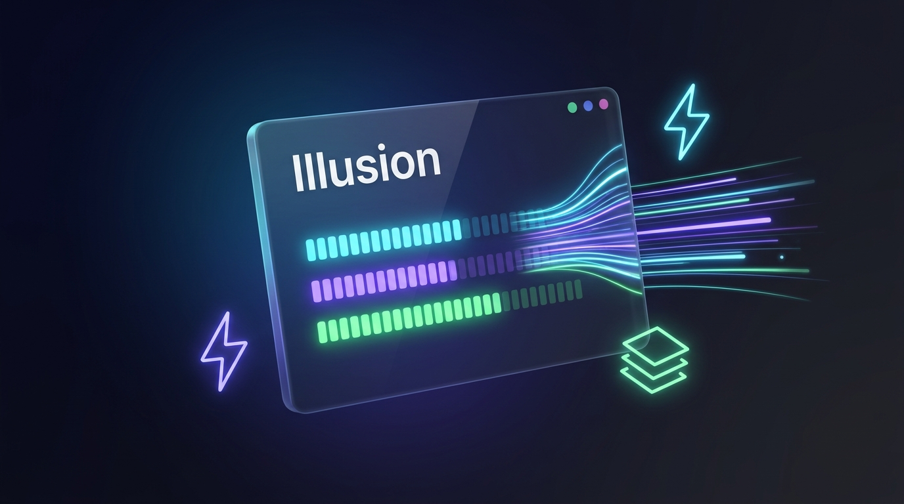

<div align="center">


# Illusion

**High-speed, zero-`yt-dlp` download manager for Linux & Wayland, written in Rust.**

[](Cargo.toml)
[](hyprland/illusion.conf)
[](LICENSE)

</div>

---

Illusion replaces proprietary Windows download accelerators on Linux with a lock-free Rust transfer engine, kernel-backed file allocation, and native browser stream interception—with no Python or `yt-dlp` dependencies.

## Engineering

- **CUSUM Stall & Collapse Recovery** — Monitors per-connection throughput via dual-window EWMA and two-sided CUSUM; detects degraded sockets early and steals trailing byte ranges cleanly without repair storms.
- **Zero-Copy Storage (`fallocate` + `pwrite64`)** — Pre-allocates target files upfront and writes coalesced 64 KB blocks directly at byte offsets, eliminating `.part` concatenation.
- **Native Media Resolution** — Extracts streams directly in Rust across YouTube (InnerTube + `base.js` deciphering), Facebook, Instagram, TikTok, X, HLS (`.m3u8`), and MPEG-DASH (`.mpd`), muxing adaptive tracks via zero-copy `ffmpeg -c copy`.
- **Main-World Browser Hooking** — Intercepts `fetch`, `XHR`, `MediaSource`, and browser downloads over Chrome/Firefox Native Messaging and Unix Domain Sockets.

<div align="center">



</div>

## Architecture

| Component | Role |
| :--- | :--- |
| [`illusion-core`](crates/illusion-core) | Adaptive range scheduler, CUSUM detector, `pwrite64` I/O, stream & InnerTube resolvers |
| [`illusion-gui`](crates/illusion-gui) | Wayland-native desktop UI (`eframe`/`egui`), D-Bus tray (`ksni`), UDS IPC server |
| [`illusion-cli`](crates/illusion-cli) | Terminal client (`add`, `list`, `resume`, `remove`) |
| [`illusion-native-host`](crates/illusion-native-host) | Length-prefixed stdio JSON bridge for browser extensions |
| [`extension`](extension) / [`extension-firefox`](extension-firefox) | Manifest V3 extensions with floating video bar and audio/video track pairing |

## Install (Arch Linux & Hyprland)

```bash
sudo pacman -S rust ffmpeg desktop-file-utils
git clone https://github.com/maruf7705/Illusion.git && cd Illusion
./scripts/install.sh
```

The installer builds release binaries into `~/.local/bin/`, registers Native Messaging hosts for Chrome, Chromium, and Firefox, and installs Hyprland rules to `~/.config/hypr/illusion.conf`.

- **Hyprland:** Add `source = ~/.config/hypr/illusion.conf` to `~/.config/hypr/hyprland.conf`.
- **Chrome / Chromium:** Load [`extension/`](extension/) via `chrome://extensions/` (Developer mode).
- **Firefox:** Load [`extension-firefox/manifest.json`](extension-firefox/manifest.json) via `about:debugging`.

## CLI

```bash
illusion-cli add "https://example.com/file.iso" --conns 16 -d ~/Downloads
illusion-cli list
illusion-cli resume <task-id>
illusion-cli remove <task-id>
```

## Verify

```bash
cargo test --workspace
```

## License

[MIT](LICENSE) © [maruf7705](https://github.com/maruf7705)
